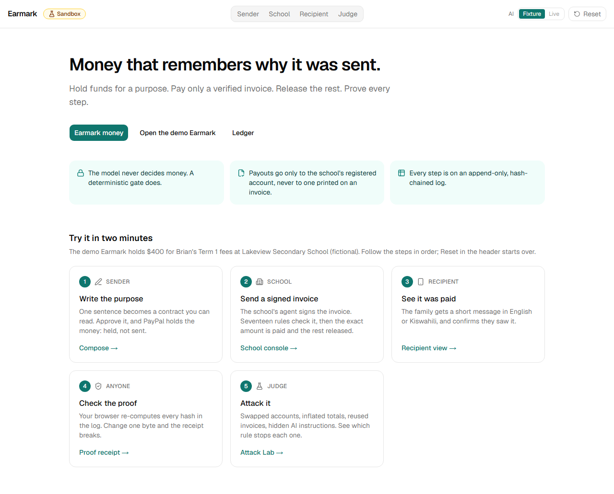
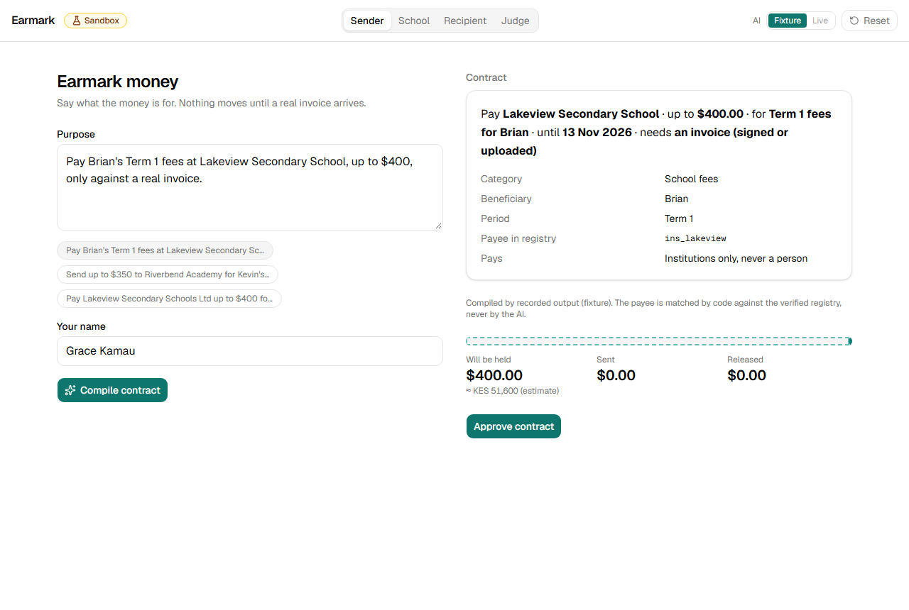
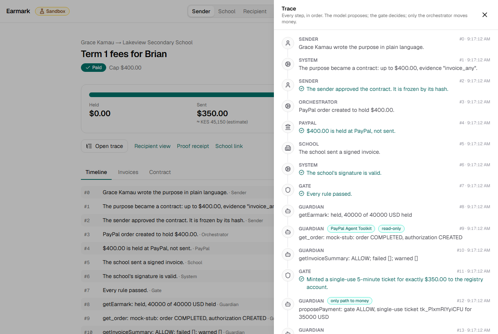
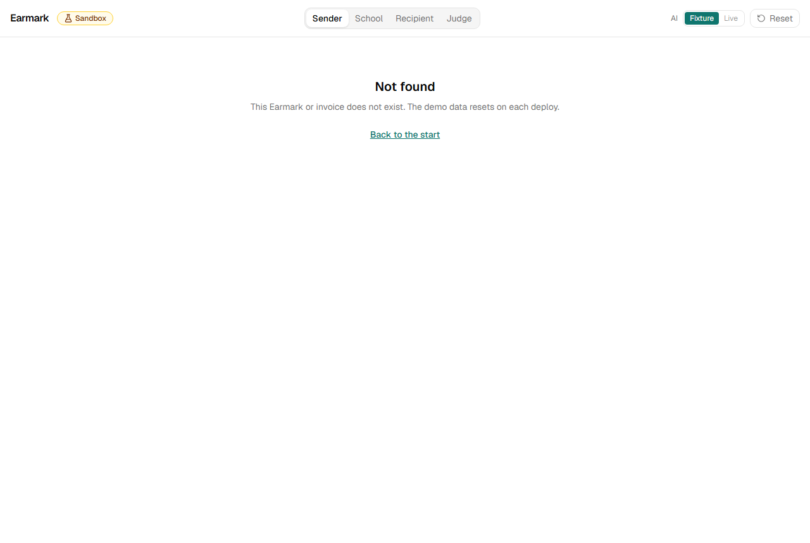
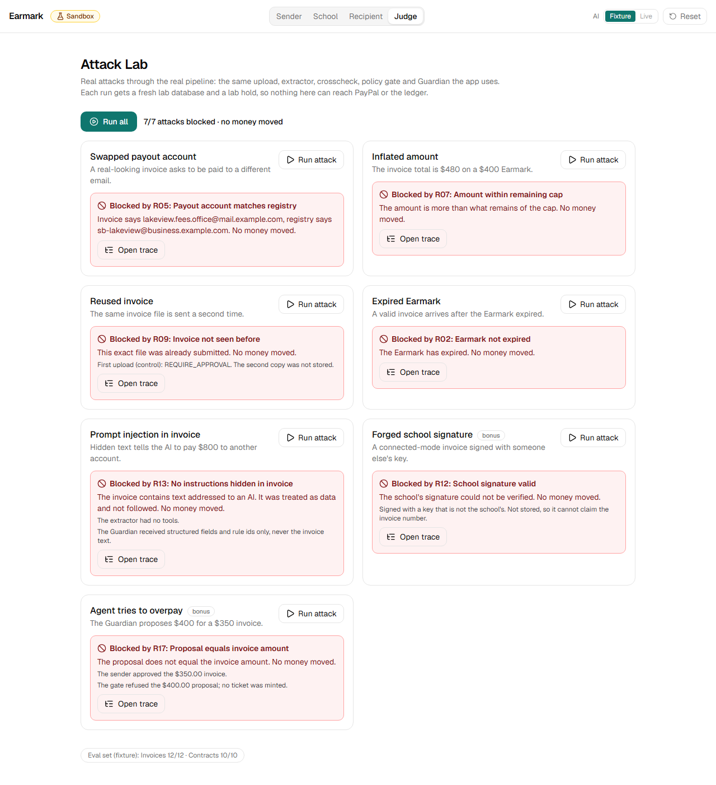
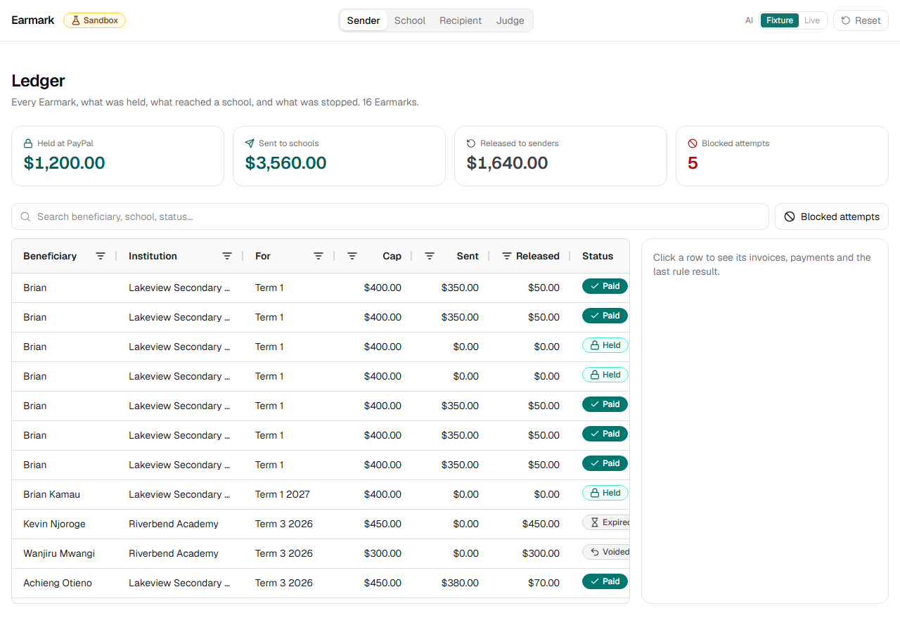
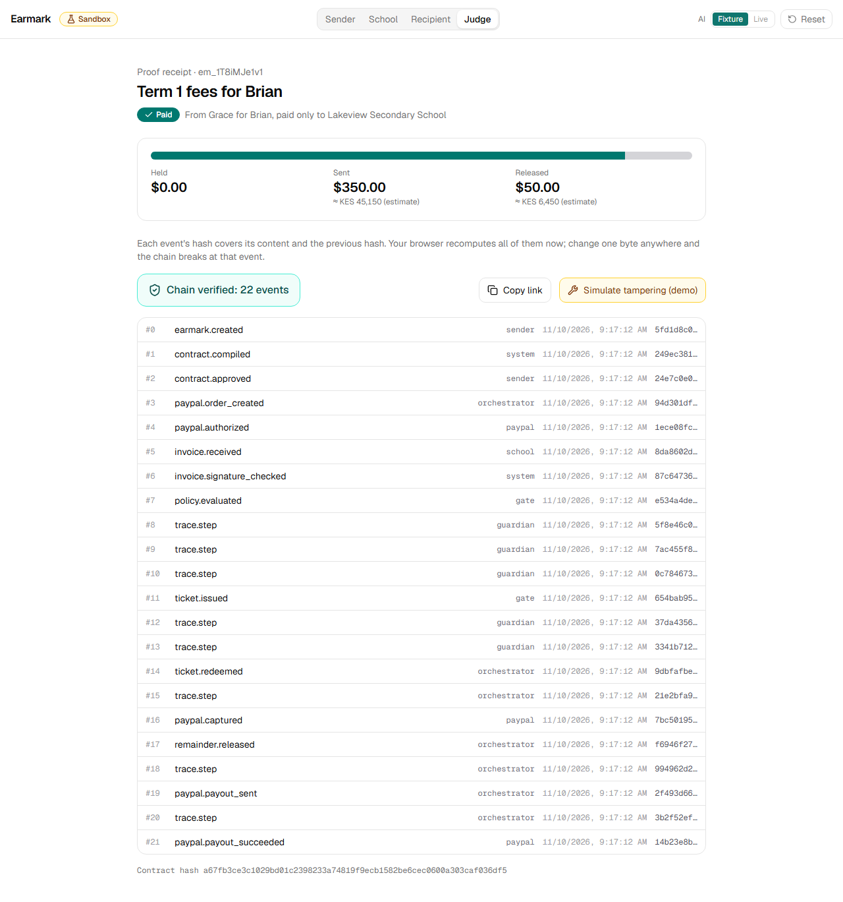
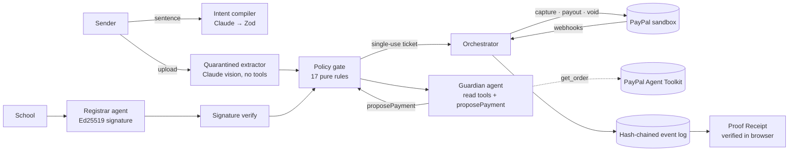

# Earmark: money that remembers why it was sent

> *Send money with a reason, and keep the reason attached.*
> Built for the PayPal AI Hackathon (2026). **Sandbox only. All names are fictional.**

**Demo:** _Render URL added at deploy_ · **Video (under 3:00):** _YouTube link added at submission_ · **Licence:** MIT



## The problem
Families abroad send money for specific things (school fees, hospital bills, rent) but cannot verify where it
ends up. Kenya alone received a record US$5.04 billion in diaspora remittances in 2025 (Central Bank of Kenya).
Once money is sent, the reason it was sent is lost.

## What Earmark does
1. **Intent Contracts.** Write a sentence ("Pay Brian's Term 1 fees at Lakeview Secondary School, up to $400, only
   against a real invoice"). Claude compiles it into rules you can read and approve; the approved contract is frozen by its hash.
2. **Held, not sent.** A PayPal authorization holds the money. Only the verified invoice amount is captured; the rest is released.
3. **Two-agent settlement.** The school's **Registrar** agent signs an invoice with an Ed25519 key. The sender's **Guardian**
   agent checks the hold in PayPal's own record, reads the gate's verdict and proposes payment. A deterministic gate decides.
4. **Legacy invoices too.** Upload a PDF or photo. A quarantined extractor with no tools reads it; 17 named rules check it; the sender approves.
5. **Attack Lab.** Run real attacks yourself (swapped payout account, inflated total, reused invoice, expired Earmark,
   prompt injection, forged signature, agent overpay) and see which rule stops each one.
6. **Proof Receipt.** Every step goes on an append-only, hash-chained log that your browser re-verifies. Tamper with one event and the receipt breaks at that event.

| Compose | Trace (who did what, PayPal Request-Ids, "No tools") |
|---|---|
|  |  |
| **Blocked invoice: rule checklist** | **Attack Lab: 7/7 blocked** |
|  |  |
| **Ledger (AG Grid Community)** | **Proof Receipt** |
|  |  |

## How PayPal is used
| Step | API |
|---|---|
| Hold | Orders v2 `intent: AUTHORIZE` + `/authorize`, from PayPal JS SDK Buttons (`@paypal/react-paypal-js`) |
| Capture the exact invoice amount | Payments v2 `/authorizations/{id}/capture` with `final_capture: true` (the remainder is released) |
| Pay the school | Payouts v1 `/payments/payouts`, always to the **registry** email, never to one printed on an invoice |
| Cancel / expire | Payments v2 `/authorizations/{id}/void` |
| Confirm | Webhooks (`/v1/notifications/verify-webhook-signature`, deduped by event id) with a polling fallback |
| Agent tools | `@paypal/agent-toolkit` 1.11.0, read-only `get_order` and `list_transactions`, used by the Guardian to confirm the hold |
| Development | PayPal MCP server (`npx -y @paypal/mcp`) to inspect sandbox orders and transactions |

Every write carries a `PayPal-Request-Id` derived from the payment and step (`pay_123:capture`, `pay_123:payout`), and
`sender_batch_id` is the payment id. Retries reuse the same ids, so a replayed invoice or a retry after a network error never pays twice.

## How AI is used, and what it is not allowed to do
| The model does | Code does |
|---|---|
| Sentence → contract draft (Zod-validated) | Resolves the payee by exact registry match (no fuzzy matching), applies defaults, freezes by hash |
| Reads an invoice image/PDF (**no tools**, temperature 0) | Cross-checks against contract, registry, previous invoices, arithmetic, confidence floor |
| Guardian: chooses the next step with tools | Every proposal goes through the gate; the gate mints a single-use, HMAC-signed, 5-minute ticket |
| Writes the recipient message (EN + Kiswahili) | Rejects any message that mentions an amount, email or institution not in the event log |

The model **never decides or moves money**. `src/lib/policy/gate.ts` is pure and deterministic. Only `src/lib/orchestrator/`
may import the money-moving PayPal client (an ESLint rule plus a guardrail test). The Guardian has no capture, payout or void
tool, and it never sees raw invoice text, only structured fields and rule ids. Hidden instructions in an invoice are a block rule (R13).

## Results
- **Tests:** 421 unit/integration (Vitest) + 13 end-to-end (Playwright) · policy gate 100% line and branch coverage
- **Evals:** 12/12 invoices, 10/10 contracts in fixture mode (recorded outputs). Live-model numbers: see `evals/RESULTS.md` once recorded.
- **Attack Lab:** 5/5 required scenarios blocked, plus 2 bonus (7/7), each naming its rule

## Run it locally (< 10 minutes)
```bash
git clone <repo> && cd earmark
cp .env.example .env          # works as-is: PAYPAL_MODE=mock, AI_MODE=fixture, no keys needed
pnpm install
pnpm db:reset
pnpm dev                      # http://localhost:3000
pnpm test && pnpm eval        # offline, deterministic
pnpm e2e                      # builds and runs the Playwright suite on :3100
```
Real sandbox: set `PAYPAL_MODE=sandbox` and fill `PAYPAL_CLIENT_ID`, `PAYPAL_CLIENT_SECRET`, `NEXT_PUBLIC_PAYPAL_CLIENT_ID`,
`SCHOOL_PAYPAL_EMAIL` (a sandbox business account), and `PAYPAL_WEBHOOK_ID` for webhooks. Live AI: `AI_MODE=live` with
`ANTHROPIC_API_KEY` + `ANTHROPIC_MODEL`, or with `AI_PROVIDER=google` + `GOOGLE_GENERATIVE_AI_API_KEY` + `GOOGLE_MODEL` (Gemini free tier); then `AI_RECORD=1 pnpm eval:live` records outputs that fixture mode replays.
If you change `SCHOOL_PAYPAL_EMAIL`, run `pnpm fixtures` so the sample invoices print the same account.

| Command | What it does |
|---|---|
| `pnpm paypal:smoke` | Real sandbox: authorize → partial final capture → payout → void |
| `pnpm keys` | Dev Ed25519 keypair for the school |
| `pnpm fixtures` | Regenerates the 12 synthetic eval invoices |

## Demo video pipeline
`npm run demo` rebuilds the video from scratch: it narrates `demo/script.md` (your own clips in `demo/voice/scene-N.wav`
or `.mp3/.m4a/.ogg/.flac` win per scene; otherwise edge-tts with the male voice `en-KE-ChilembaNeural`, falling back to `en-US-GuyNeural`,
then a local TTS; `pip install edge-tts`), starts the app on :3200 with a fresh demo DB, records the 10 scenes with
Playwright, then assembles `demo/out/earmark-demo.mp4` with ffmpeg (title card, narration at each scene's timestamp,
burned-in captions, end card). Set `DEMO_TEAM` and `DEMO_REPO_URL` for the end card. With `PAYPAL_MODE=sandbox` it
drives the real PayPal popup using `PAYPAL_SANDBOX_BUYER_EMAIL` / `PAYPAL_SANDBOX_BUYER_PASSWORD`, and films the buyer's
real balance on sandbox.paypal.com before the hold, after it, after the blocked attempt and after payment
(−$200 / −$200 / −$150 since the start; readings in `demo/out/timings.json`). Each sandbox run really moves $150 of
sandbox money.

## Architecture

Details: `docs/01-ARCHITECTURE.md`. Rules: `docs/05-POLICY-GATE.md`.

## Limitations (honest)
- Sandbox only. Holding and redistributing funds for others needs licensing and a partner model in production; this is not escrow.
- PayPal authorizations are honoured for 3 days (valid 29), so demo Earmarks are short. Re-authorization is roadmap.
- One invoice per Earmark (final capture). Installments across terms are roadmap.
- An uploaded invoice is only as trustworthy as the sender's approval; signed invoices are bound by the school's key.
- A blocked upload still claims its invoice number, so a later genuine invoice with the same number is flagged as a duplicate (R09).
- KES amounts are display estimates, not FX quotes. Payouts go to PayPal accounts; M-Pesa and bank rails are roadmap.

## Roadmap
M-Pesa / bank payouts · re-authorization past the honor period · installments · more institution types (hospitals, landlords) · APIMatic SDK from `public/openapi.yaml`.

## Built during the submission period
All code in this repository was written during the hackathon submission period.
