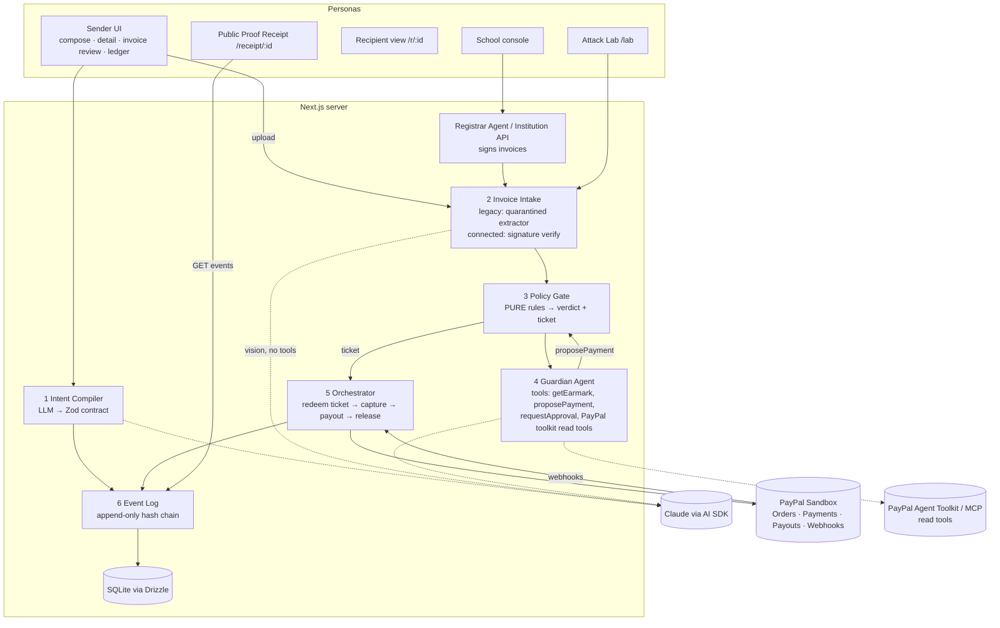
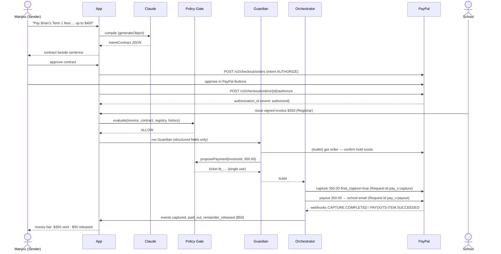
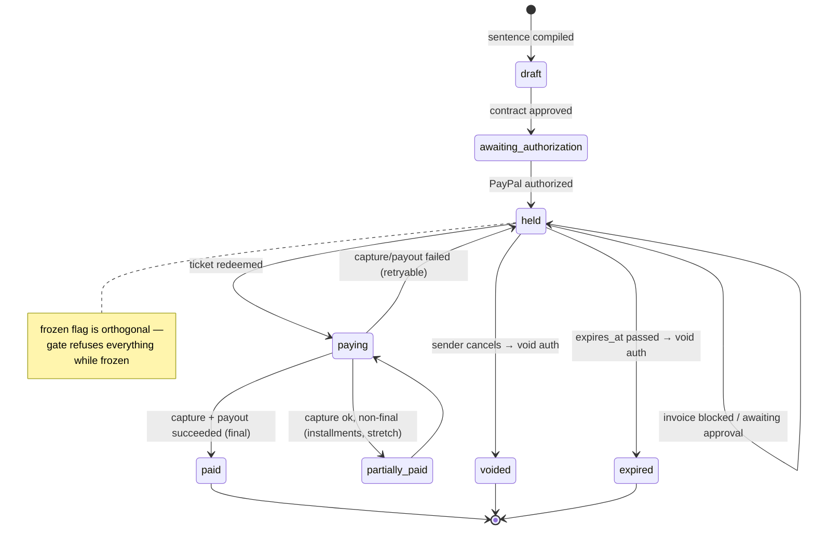

# 01 — Architecture

## One-line summary

One Next.js app. Claude handles language and vision. A deterministic policy gate makes every money
decision. Only the orchestrator talks to PayPal's money-moving endpoints.

## Component diagram



## Trust boundaries

| Boundary | Untrusted input | Defence |
|---|---|---|
| Sender sentence → contract | Free text | `generateObject` + Zod; sender must confirm; contract frozen (hashed) once approved |
| Invoice file → extractor | Image/PDF possibly containing prompt injection | Extractor has **no tools**, temperature 0, Zod output only, output fields are data never instructions |
| Extractor output → gate | Possibly wrong/malicious values | Gate cross-checks against contract, registry, previous hashes, arithmetic; confidence floor |
| Guardian agent → money | LLM tool calls | Guardian can only `proposePayment`; gate mints single-use ticket; orchestrator redeems |
| Signed invoice → gate | Forged JSON | Ed25519 signature checked against registry public key |
| PayPal webhook → event log | Spoofed POST | Verify via `POST /v1/notifications/verify-webhook-signature`; dedupe on event id |
| Public receipt | — | Read-only; client recomputes hashes itself |

## End-to-end sequence (happy path, connected mode)



## Earmark state machine



Status values (DB): `draft | awaiting_authorization | held | paying | partially_paid | paid | voided | expired`.

## Module dependency rules

```
app/*  → lib/agents, lib/orchestrator, lib/contract, lib/invoice, lib/events, lib/db (read)
lib/agents      → lib/policy (proposePayment only), lib/paypal/toolkit (read tools), lib/db (read)
lib/orchestrator→ lib/policy/tickets (redeem), lib/paypal/client (capture/payout/void), lib/events
lib/policy      → nothing with I/O. Takes a fully-built `GateContext` object. Pure functions.
lib/events/canonical.ts → no Node imports (used in browser)
lib/paypal/client.ts exports money-moving fns; ESLint restricts their import to lib/orchestrator/** and scripts/**
```

Add to `.eslintrc`:
```js
"no-restricted-imports": ["error", { patterns: [{
  group: ["**/lib/paypal/client", "@/lib/paypal/client"],
  message: "Only lib/orchestrator may move money."
}]}]
```
…with an `overrides` entry that turns it off for `src/lib/orchestrator/**`, `src/lib/paypal/**`, `scripts/**`, `tests/**`.

## Why these choices

- **Single Next.js app**: one deployable, server routes keep secrets, fewer moving parts on camera.
- **SQLite + seed on boot**: zero setup for judges; reset button rebuilds demo state. Render free disk is
  ephemeral — acceptable *because* we seed on boot.
- **AI SDK**: the PayPal Agent Toolkit ships an AI SDK adapter, so Guardian tools and PayPal tools live in one `tools` object.
- **Deterministic gate**: the defensible story for an agent that spends money.
